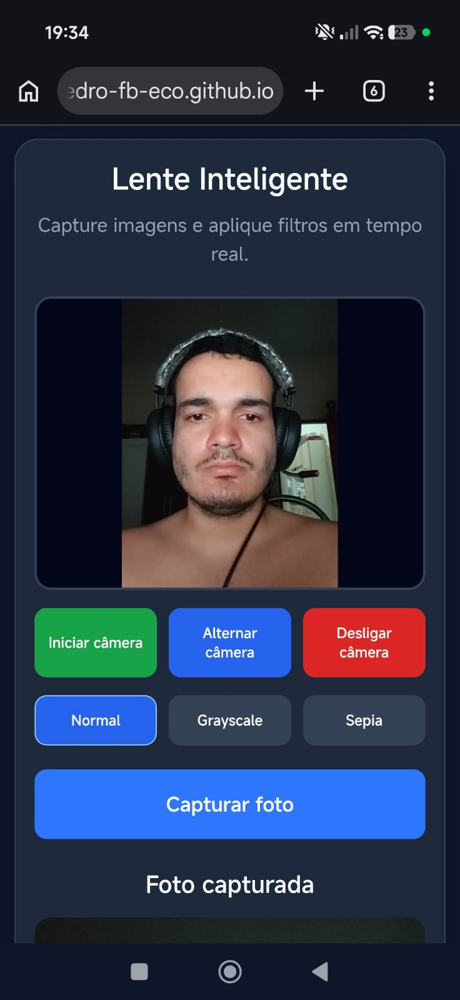

# 📷 Lente Inteligente


## 📖 Sobre o projeto

A Lente Inteligente é uma aplicação web responsiva desenvolvida
para capturar fotografias e aplicar filtros de imagem em tempo
real, diretamente pelo navegador de dispositivos móveis.

O projeto foi desenvolvido como atividade acadêmica do Workshop
P2 da disciplina de Front-End Tecnologia, na Universidade
Católica Dom Bosco (UCDB).

A aplicação utiliza recursos nativos do navegador para acessar
a câmera do dispositivo e processar imagens localmente, sem
necessidade de instalação de aplicativos ou utilização de backend.

## 🌐 Acesse a aplicação

**[Acessar Lente Inteligente](https://pedro-fb-eco.github.io/lente-inteligente/)**

Para utilizar todas as funcionalidades, acesse pelo celular
e permita o acesso à câmera.

## 🎯 Objetivos

- Integrar uma aplicação web aos recursos de hardware do dispositivo.
- Capturar imagens utilizando a câmera do celular.
- Aplicar filtros em tempo real.
- Processar imagens utilizando a Canvas API.
- Desenvolver uma interface responsiva.
- Permitir o download das fotografias processadas.

## ⚙️ Funcionalidades

- [x] Acesso à câmera do dispositivo.
- [x] Visualização de vídeo em tempo real.
- [x] Alternância entre câmera frontal e traseira.
- [x] Desligamento da câmera.
- [x] Modo Normal.
- [x] Filtro Grayscale (escala de cinza).
- [x] Filtro Sepia.
- [x] Captura de fotografias.
- [x] Download de imagens em PNG.
- [x] Interface responsiva.
- [x] Tratamento de erros de acesso à câmera.
- [x] Hospedagem no GitHub Pages.

## 🛠️ Tecnologias utilizadas

| Tecnologia | Finalidade |
|---|---|
| HTML5 | Estrutura da aplicação |
| CSS3 | Estilização, responsividade e filtros visuais |
| JavaScript | Controle da câmera e processamento de imagens |
| getUserMedia API | Acesso à câmera do dispositivo |
| Canvas API | Captura e manipulação dos pixels |
| Git | Controle de versão |
| GitHub | Armazenamento do código-fonte |
| GitHub Pages | Hospedagem da aplicação |
| Visual Studio Code | Ambiente de desenvolvimento |
| LaTeX e Overleaf | Documentação acadêmica |

## 📂 Estrutura do projeto

```text
lente-inteligente/
├── index.html
├── style.css
├── script.js
├── README.md
├── docs/
│   └── paper.pdf
└── images/
    ├── interface-mobile.jpeg
    ├── normal.jpeg
    ├── grayscale.jpeg
    └── sepia.jpeg
```

## 📱 Interface da aplicação

<p align="center">
  
</p>

## 🎨 Filtros disponíveis

| Normal | Grayscale | Sepia |
|:---:|:---:|:---:|
|  |  |  |
| Cores originais | Escala de cinza | Tonalidades envelhecidas |

As fotografias foram obtidas utilizando a própria aplicação
durante os testes funcionais.

## 🔄 Funcionamento da aplicação

1. O usuário solicita acesso à câmera.
2. A API getUserMedia obtém a transmissão de vídeo.
3. O elemento HTML video exibe a imagem em tempo real.
4. Os filtros CSS alteram a visualização da câmera.
5. A Canvas API captura um quadro do vídeo.
6. O JavaScript processa os pixels da fotografia.
7. A imagem resultante é disponibilizada para download.

Todo o processamento das fotografias ocorre localmente
no navegador.

## 🧪 Ambiente de testes

| Característica | Descrição |
|---|---|
| Dispositivo | POCO F8 |
| Navegador | Google Chrome |
| Hospedagem | GitHub Pages |
| Protocolo | HTTPS |
| Tipo de teste | Funcional manual |
| Processamento | Local, no navegador |

## 📊 Resultados

Os testes funcionais realizados no dispositivo móvel
demonstraram o funcionamento das principais funcionalidades
propostas, incluindo o acesso à câmera, a aplicação dos filtros,
a captura e o download das fotografias.

Os resultados correspondem a uma avaliação funcional
qualitativa, sem medições quantitativas de desempenho.

## 🔒 Privacidade e segurança

- O acesso à câmera depende da autorização do usuário.
- As fotografias são processadas localmente.
- A aplicação não envia as imagens para servidores externos.
- A hospedagem utiliza o protocolo HTTPS.
- O usuário pode desligar a câmera a qualquer momento.

## 💻 Executando localmente

Clone o repositório:

```bash
git clone https://github.com/Pedro-FB-ECO/lente-inteligente.git
```

Acesse a pasta do projeto:

```bash
cd lente-inteligente
```

Abra o projeto no Visual Studio Code e execute o arquivo
index.html utilizando a extensão Live Server.

É necessário possuir uma câmera disponível e utilizar
um contexto seguro, como localhost ou HTTPS.

## 📄 Documentação acadêmica

O desenvolvimento do projeto foi documentado em um artigo
acadêmico elaborado em LaTeX, utilizando o Overleaf e o
modelo disponibilizado pela UCDB.

**Título:** Lente Inteligente: Captura e Processamento de
Imagens em Navegadores Móveis.

**[Acessar o paper completo](docs/paper.pdf)**

## 📚 Referências técnicas

- [MDN - Taking still photos with getUserMedia](https://developer.mozilla.org/en-US/docs/Web/API/Media_Capture_and_Streams_API/Taking_still_photos)
- [MDN - MediaDevices.getUserMedia](https://developer.mozilla.org/en-US/docs/Web/API/MediaDevices/getUserMedia)
- [W3C - Filter Effects Module Level 1](https://www.w3.org/TR/filter-effects-1/)

## 🚀 Trabalhos futuros

- Implementação de uma galeria de fotografias.
- Adição de novos filtros.
- Controle de brilho e contraste.
- Testes de desempenho.
- Avaliação de compatibilidade em diferentes dispositivos.

## 👨‍💻 Autor

**Pedro Ferreira Bastos**

- Universidade Católica Dom Bosco — UCDB
- Disciplina: Front-End Tecnologia
- Professor: Renato Gil Arruda Vieira
- Atividade: Workshop P2 — Interface & Hardware
- Ano: 2026
- [Perfil no GitHub](https://github.com/Pedro-FB-ECO)

---

<p align="center">
  Projeto desenvolvido para fins acadêmicos — UCDB, 2026.
</p>